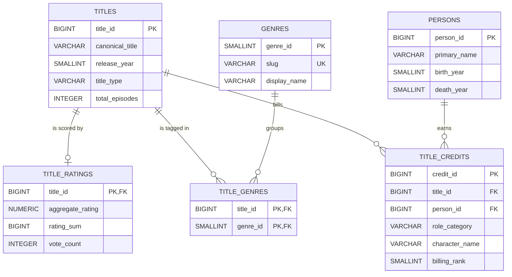

# TV Show Catalog: Design Practice ERD

My TV show catalog design as an entity relationship diagram. Six tables in 3NF/BCNF,
drawn from my design paper (title aggregation view and person filmography view).

## Reading each line both ways

- One title has zero or one ratings row; one ratings row belongs to exactly one title.
  Ratings live in their own 1:1 table so heavy vote traffic never locks catalog rows,
  and an unrated title is a missing row (NULL rating), not a fake 0.0.
- One title appears in zero or more title_genres rows; each title_genres row points to
  exactly one title. One genre groups zero or more title_genres rows; each row points
  to exactly one genre. Together they resolve the many-to-many between titles and genres,
  with the composite key (title_id, genre_id) blocking duplicate tags.
- One title bills zero or more credits; each credit belongs to exactly one title.
  One person earns zero or more credits; each credit names exactly one person.
  The unique constraint (title_id, person_id, role_category) lets the same person hold
  several roles on one title (actor and writer and creator) without duplicate rows.

## Where this differs from the class comparison

- Ratings are split out of titles into a 1:1 table (concurrency isolation), where the
  slide version kept the aggregate on the title row.
- Seasons and episodes are not separate tables here; total_episodes is kept on titles
  as a cached counter. A fuller build would add seasons and episodes tables under titles.
- Credits use one polymorphic table with role_category instead of separate stars and
  writers tables, so new role types need no schema change.
