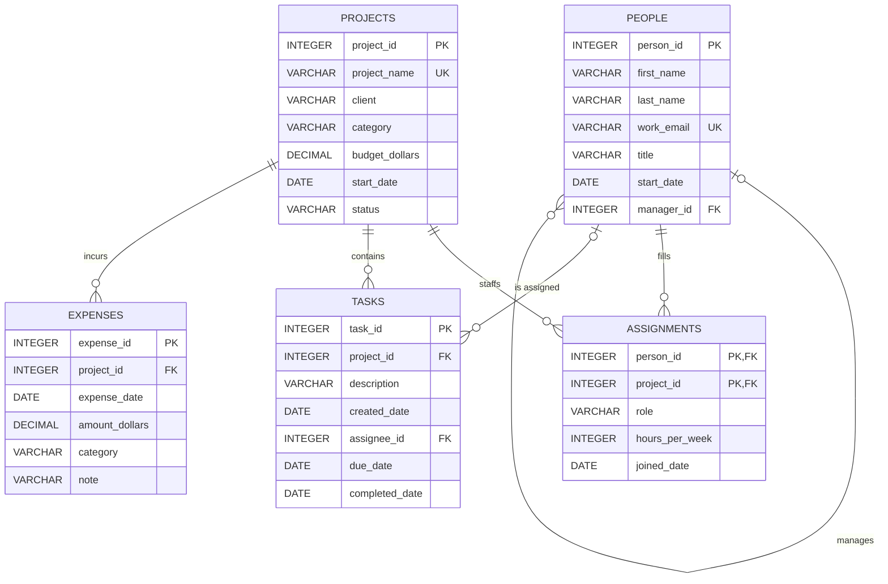

# BabsonAI Labs: the lab's first database

## 1. The Scenario

Scenario A. BabsonAI Labs is an AI consulting lab of about 25 people that runs client and internal projects, and it has been keeping everything in spreadsheets. The lab keeps track of its people (name, work email, title, start date, and who they report to; the two founders report to nobody, and emails change when titles change); its projects (name, client, which is empty for internal projects, a category that is one of LLM app, data pipeline, or internal tool, a budget, a start date, and a status that is one of planned, active, paused, or done); who works on what (a person can work on several projects and a project has several people, each pairing with a role, hours per week, and the date they joined the project); tasks (each belongs to one project, with a description, a created date, an assignee that may be empty, a due date, and a completed date that stays empty until the task is done); and expenses (each belongs to one project, with a date, an amount, a category that is one of GPU cloud, data labeling, software, or travel, and a short note).

The lab's rules: each person reports to at most one other person who also works at the lab. Budgets and expenses are above zero. A task belongs to one project and has at most one assignee, and cannot be completed before it was created. A person puts in between 1 and 40 hours a week on any one project. A task is assigned only to someone who works on its project, and never before that person's start date at the lab.

## 2. The ERD

Reading the ends: a person is managed by zero or one person, and manages zero or more. Every assignment names exactly one person and one project; a person holds zero or more assignments, and a project has zero or more people on it. Every task belongs to exactly one project; its assignee is zero or one person. Every expense belongs to exactly one project; a project has zero or more tasks and zero or more expenses.

## 3. What One Row Means

- One row of `people` is one person who works at the lab.
- One row of `projects` is one project the lab runs, for a client or for itself.
- One row of `assignments` is one person's seat on one project, with their role and weekly hours.
- One row of `tasks` is one piece of work to be done on one project.
- One row of `expenses` is one purchase charged to one project.

## 4. Design Choices

